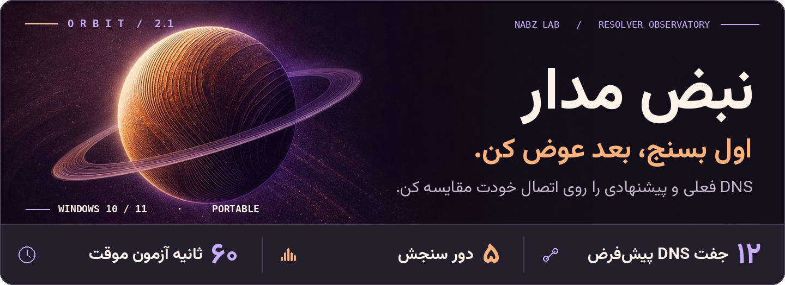
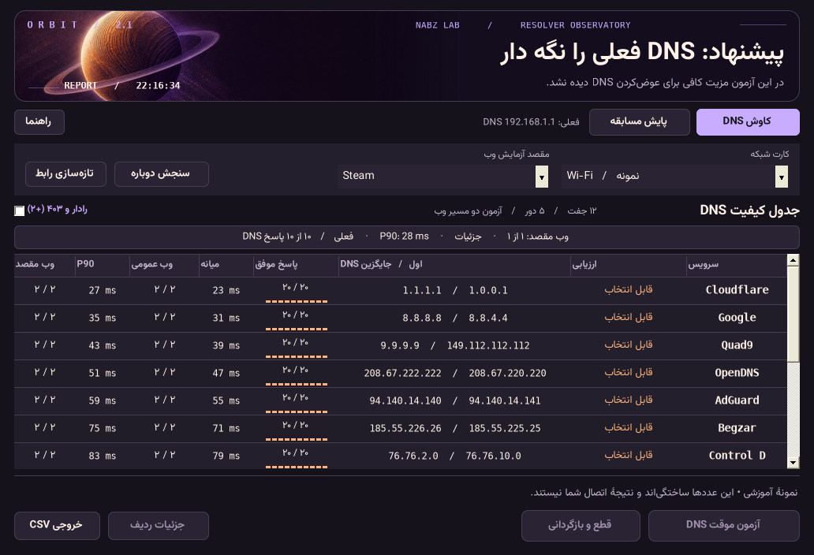
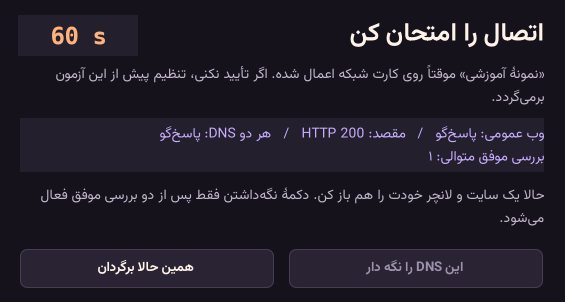

  

# نبض مدار | کاوش DNS برای ویندوز

**DNS فعلی‌ات را عوض کنی یا نه؟** مقصد را انتخاب کن و ببین با کدام جفت DNS، هم وب‌سایت آن سرویس و هم یک سایت عمومی از اتصال خودت باز می‌شوند. اگر DNS فعلی به همان خوبی کار کند، پیشنهاد مدار این است که آن را نگه داری.

**[دریافت نسخهٔ ویندوز](https://github.com/bigboos2018/NabzOrbit/releases/latest)** &nbsp; · &nbsp; [راهنمای کامل فارسی](docs/orbit/manual-fa.md) &nbsp; · &nbsp; [نتیجهٔ آزمون‌ها](docs/TEST-RUN.txt)

در صفحهٔ دانلود، زیر **Assets** فایل `NabzOrbit-2.1-Windows.zip` را بگیر. آن را استخراج کن و `NabzOrbit.exe` را عادی باز کن. فایل **Source code (zip)** برای ساختن برنامه از روی کد است، نه اجرای مستقیم. کاوش به مجوز مدیر نیاز ندارد؛ تغییر و بازگردانی DNS نیاز دارد.

## ۰۱ / کاوش DNS

کارت شبکه‌ات و یک مقصد مثل Steam، Xbox یا PyPI را انتخاب کن. مدار **پایداری پاسخ هر دو نشانی** و بازشدن صفحهٔ مقصد را با DNS فعلی همان کارت مقایسه می‌کند. روی ردیف دوبار کلیک کن تا ببینی چرا یک جفت پیشنهاد شده یا کنار گذاشته شده است.

*تصویر آموزشی از رابط واقعی برنامه است؛ عددها و رتبه‌ها نتیجهٔ اندازه‌گیری روی اینترنت تو نیستند.*

## ۰۲ / پیش از نگه‌داشتن، امتحان کن

ردیف «قابل انتخاب» را با **«آزمون موقت»** امتحان کن. در فرصت ۶۰ ثانیه‌ای، خودت هم یک سایت و لانچرت را باز کن. دکمهٔ **«این DNS را نگه دار»** بعد از دو بررسی موفقِ پیاپی فعال می‌شود. اگر تأیید نکنی یا دو بررسی پیاپی ناموفق شوند، برنامه تنظیم پیش از همان آزمون را برمی‌گرداند.

پنجرهٔ آزمون ۶۰ ثانیه‌ای را ببین

**اگر بعد از یک تغییر، سایت‌ها باز نمی‌شوند:** روی **«قطع و بازگردانی»** بزن. این دکمه اینترنت را قطع نمی‌کند؛ تنظیم DNS همان کارت را به حالت قبل از اولین تغییر برمی‌گرداند. برای خواندن پشتیبان اینترنت لازم نیست. در صورت قطع برق یا شکست بازیابی، [راهنمای بازگردانی](docs/orbit/manual-fa.md) را ببین.

## ۰۳ / لحظهٔ قطعی را ثبت کن

پیش از بازی **«پایش مسابقه»** را شروع کن. وقتی ارتباط می‌پرد، **«ثبت لحظهٔ قطعی»** را بزن. بعد می‌توانی در نمودار و CSV محلی ببینی در همان بازه مودم، یک مسیر بیرونی بدون DNS و DNS فعلی چه پاسخی داده‌اند. مدار وسط بازی خودسرانه DNS را عوض نمی‌کند.

بازشدن صفحهٔ یک سرویس، ورود به حساب یا پایداری سرور مسابقه را تضمین نمی‌کند. برنامه فقط تنظیم **DNS نسخهٔ چهار کارت انتخابی** را عوض می‌کند، نه IP، مودم، فایروال یا IPv6 را.

---

**برای بررسی و ساخت:** [منابع نشانی‌ها](docs/SOURCES.md) · [روش تست و محدودیت‌ها](docs/TESTING.md) · [ساخت روی ویندوز](build.cmd) · [مجوز کد](LICENSE) · [مجوز فونت وزیرمتن](assets/OFL.txt)

