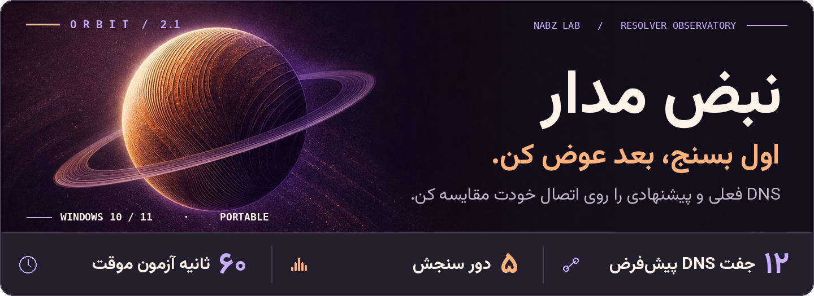

**اول بسنج، بعد عوض کن.** نبض مدار ۲٫۱ پیش از پیشنهاد یک DNS جدید، آن را با DNS فعلی کارت شبکه‌ات مقایسه می‌کند. اگر برتری روشنی نبیند، پیشنهادش این است که تنظیم فعلی را نگه داری.

- **کاوش DNS:** ۱۲ جفت پیش‌فرض در ۵ دور؛ بررسی پایداری هر دو نشانی، وب مقصد و وب عمومی. دو جفت با نشانی خصوصی، مخصوص بعضی مسیرهای ایران، فقط با انتخاب خودت اضافه می‌شوند.
- **آزمون موقت:** بعد از اعمال موقت، یک سایت و سرویس خودت را امتحان کن. برای نگه‌داشتن، دو بررسی موفقِ متوالی و تأیید تو لازم است. اگر تا ۶۰ ثانیه تأیید نکنی، برنامه تنظیم قبلی را بازمی‌گرداند.
- **پایش مسابقه:** لحظهٔ قطعی را علامت بزن و نتیجهٔ مودم، مسیر بیرونی و DNS را در CSV محلی ببین. این اندازه‌گیری پینگ سرور بازی نیست.

**دانلود و اجرا:** زیر **Assets** فایل `NabzOrbit-2.1-Windows.zip` را بگیر، استخراج کن و `NabzOrbit.exe` را باز کن. مناسب ویندوز ۱۰ و ۱۱؛ بدون نصب. `Start-here.html` راهنمای فارسی آفلاین است. فایل اجرایی امضای تجاری ندارد؛ حفاظت ویندوز را خاموش نکن.

اگر بعد از تغییر DNS سایت‌ها باز نشدند، **«قطع و بازگردانی»** را بزن. برای بازیابی از پشتیبان محلی به اینترنت نیاز نداری.

